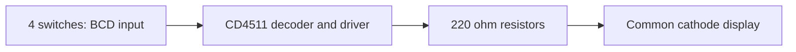

# 7-Segment Display with CD4511

Drive a common cathode 7-segment display from switches with a CD4511 BCD decoder. No Arduino or microcontroller is needed.

## Components

| Part | Quantity |
|---|---|
| CD4511 BCD to 7-segment decoder | 1 |
| Common cathode 7-segment display | 1 |
| 220 ohm resistors, one per segment | 7 |
| DIP switch or push buttons | 4 inputs |
| 10 k ohm pull-down resistors, one per input | 4 |
| Breadboard, jumper wires, 5 V supply | |

The pull-down resistors keep an open switch at logic 0. CMOS inputs must not be left floating.

## Connections

| CD4511 | Connect to |
|---|---|
| VDD (16) | +5 V |
| VSS (8) | Ground |
| LT (3), BI (4) | +5 V (both active low, so off) |
| LE (5) | Ground (latch open, output follows input) |
| A (7), B (1), C (2), D (6) | Switches, A is the least significant bit |
| a (13), b (12), c (11), d (10), e (9), f (15), g (14) | Matching segment through a resistor |

Connect the display's common cathode to ground.

## Truth table

| Digit | D C B A | Digit | D C B A |
|---|---|---|---|
| 0 | 0 0 0 0 | 5 | 0 1 0 1 |
| 1 | 0 0 0 1 | 6 | 0 1 1 0 |
| 2 | 0 0 1 0 | 7 | 0 1 1 1 |
| 3 | 0 0 1 1 | 8 | 1 0 0 0 |
| 4 | 0 1 0 0 | 9 | 1 0 0 1 |

Inputs above 9 blank the display.

## Files

| File | Contents |
|---|---|
| [circuit_diagram.txt](circuit_diagram.txt) | Wiring list |
| [components.txt](components.txt) | Parts list |
| [working.txt](working.txt) | How it works |

## Related

For the Proteus simulation of this idea, see [4511-7segment-display-counter](https://github.com/SMRUTIRANJAN30/4511-7segment-display-counter).

## Author

**Smrutiranjan Sahoo**, Electronics and Communication Engineering
[GitHub](https://github.com/SMRUTIRANJAN30) · [Email](mailto:smrutiranjansahoopikun@gmail.com)
